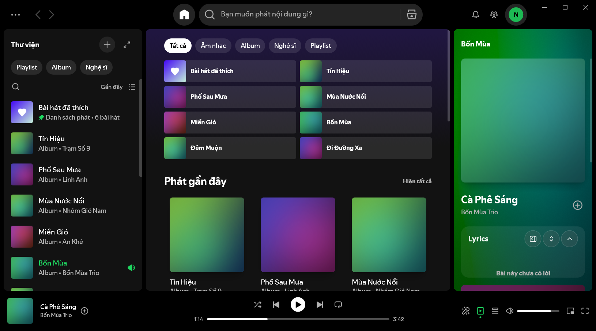
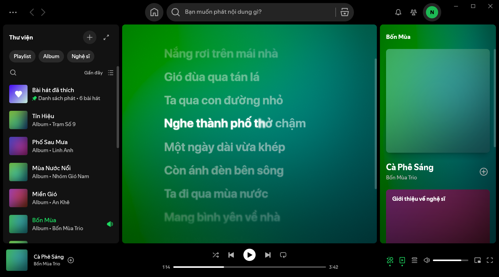

# Nhịp

A native desktop music player written in Rust (`egui`/`eframe`) with a zero-UI audio and streaming core (`nhip-core`). Plays both local audio libraries and YouTube Music streams, with a 6-band equalizer, gapless/crossfade/AutoMix transitions, loudness normalization, and word-synced lyrics over a GPU bokeh backdrop.

<p align="center">
  
  
</p>

## Features

- **Audio engine & DSP (`crates/nhip-core/src/audio/`)**
  - Gapless playback, configurable crossfade, and beat-matched AutoMix transitions (`timestretch`)
  - 6-band biquad equalizer (`-12` to `+12 dB`, `0.1 dB` step, 22 presets)
  - Loudness normalization (`-14 dB` target with Quiet/Normal/Loud volume levels) and lookahead peak limiter
  - Background next-track preloader and HTTP range stream reader (`symphonia` + `cpal`)
  - Deterministic headless output (`Engine::start_silent`) for audio/DSP tests without hardware devices
- **YouTube Music & local library**
  - Local file scanning with embedded tag/artwork reading (`lofty`) alongside YouTube Music home, search, artist, album, and playlist pages
  - Interactive Discovery Preview Feed modal (`34×44` preview pill on artist/album pages)
  - Proactive autoplay radio queue ranked by play/skip history, likes, and followed artists
  - Stream URL TTL cache, cover art prefetching, and background lyrics prefetching
- **Synced lyrics & GPU backdrop**
  - Word/syllable-synced lyrics prioritized from LyricsPlus v2 with LRCLIB and YouTube Music fallbacks, plus local `.ttml` import/export
  - Duet vocalist alignment (`v1`/`v2`), separate background vocal sub-lines, intro interlude dots, smooth exponential auto-scroll, and a morphing hover highlight pill
  - Inline, Now Playing card, Cinema, Fullscreen, and draggable floating Popup modes
  - OpenGL (`glow`) domain-warped Kawarp bokeh backdrop with `prefers_reduced_motion` support
- **Desktop ergonomics**
  - Custom frameless window chrome, collapsible/resizable sidebar, responsive `800×600` compact mode
  - Native Windows media controls (SMTC via `souvlaki`) and full keyboard shortcut map with text-input focus guards
  - Vietnamese and English UI localization

## Workspace layout

```text
.
├── crates/nhip-core/     # Pure Rust backend (zero UI dependencies)
│   └── src/
│       ├── audio/        # Mixer, DSP (EQ, limiter, normalization), AutoMix, HTTP range reader
│       ├── library.rs    # Track metadata, playlists, folders, taste scoring, persistence
│       ├── queue.rs      # Context/user queue priority, shuffle/unshuffle, repeat
│       ├── ytm.rs        # Public YouTube Music client, stream cache, lyrics racing
│       ├── lrclib.rs     # LyricsPlus v2 & LRCLIB fetchers/parsers
│       ├── lrc.rs        # Unified line/word lyric model & LRC parser
│       ├── ttml.rs       # Media-time & Apple/AMLL TTML parser
│       └── mechanics.rs  # Normalization, limiter, transition, and EQ math
├── src/                  # Desktop UI binary (`nhip`)
│   ├── main.rs           # Entry point, CLI flags, window setup
│   ├── app.rs            # Application state, action reducer, shortcuts, session restore
│   ├── art.rs            # Async artwork cache, placeholder renderer, backdrop pre-blur
│   ├── media.rs          # Windows SMTC media key bridge
│   ├── theme.rs          # Design tokens, colors, typography, embedded fonts
│   └── ui/               # Top bar, sidebar, pages, YTM views, player bar, lyrics, overlays, GLSL shaders
├── assets/fonts/         # Embedded UI and lyrics fonts
├── scripts/              # Automated UX/UI visual regression runner
├── tests/ui-baselines/   # Reference screenshots for desktop (1304×724) and compact (800×600)
└── MECHANICS.md          # Measured UI tokens, keyboard bindings, and playback/DSP rules
```

## Getting started

### Prerequisites

- **Rust** stable toolchain (2021 edition, MSVC on Windows; `rust-lld` is configured in `.cargo/config.toml` for fast linking)
- Optional: [`cargo-nextest`](https://nexte.st/) (mapped to `cargo nt` in `.cargo/config.toml`)

### Build & run

```bash
# Run in development mode
cargo run --locked

# Build release binary
cargo build --locked --release
```

On Windows, you can build a portable release package with:

```powershell
.\package-windows.ps1
```

### Demo & screenshot flags

Nhịp includes deterministic offline staging flags for layout and visual checks without touching your personal library:

```bash
# Render a specific page at a fixed viewport size to a PNG
cargo run --locked -- --size 1304x724 --page lyrics --screenshot out.png
```

Supported `--page` values include `home`, `search`, `browse`, `album`, `artist`, `playlist`, `liked`, `queue`, `lyrics`, `settings`, `profile`, and `preview`.

## Testing

```bash
# Run the full workspace test suite (145 tests across nhip-core and nhip)
cargo test --workspace --locked

# Or with cargo-nextest (recommended, faster)
cargo nt --locked
```

On Windows, run the 3-layer UX/UI and visual regression suite (unit tests + binary build + pixel diff against `tests/ui-baselines/` across `1304×724` and `800×600`):

```powershell
# Full 9-screen suite
.\scripts\ux-ui-test.ps1

# Fast 3-screen check during UI iteration
.\scripts\ux-ui-test.ps1 -Quick
```

## Contributing

Contributions are welcome — bug fixes, Linux/macOS polish, audio/DSP improvements, lyrics parser edge cases, and UI refinements.

Before opening a pull request, please read [CONTRIBUTING.md](CONTRIBUTING.md) for architecture boundaries, dependency rules, and testing guidelines.

Quick summary:
1. Fork the repository and create a feature branch off `main`.
2. Keep `crates/nhip-core` free of UI dependencies (`egui`, `eframe`, `glow`, `image`, `lofty`, `rfd`, `souvlaki`).
3. Add meaningful tests for bug fixes or behavior changes (audio/DSP tests run headlessly via `Engine::start_silent`).
4. Verify `cargo test --workspace --locked` (and `.\scripts\ux-ui-test.ps1` on Windows for UI changes) passes before submitting your PR.

## Note on third-party services

Nhịp is an independent open-source player not affiliated with Spotify or YouTube. Streaming metadata and synced lyrics are queried from public endpoints without bypassing authentication or access controls.
